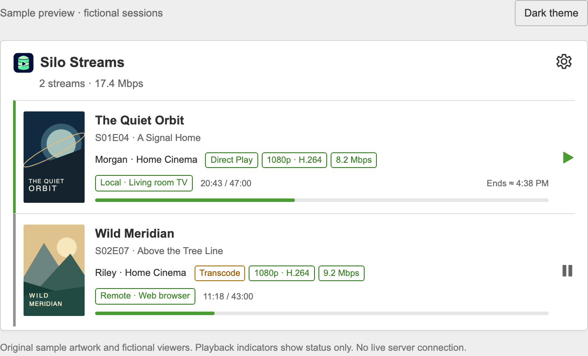

# Silo Streams

Live [Silo](https://github.com/Silo-Server/silo-server) playback monitoring on your Unraid dashboard. An independent plugin with posters, viewer and client details, playback method, quality, known bitrate and progress.



## Install

Requires Unraid 7, PHP 8.2 or later with cURL, and a Silo server with the native v2 admin monitoring API. Tested on Unraid 7.3.4 with PHP 8.4. The first public release is marked beta while it receives broader testing.

In **Plugins > Install Plugin**, paste:

```text
https://raw.githubusercontent.com/b-mannos/unraid-silo-streams/main/silo-streams.plg
```

Open **Settings > Silo Streams**, enter the native Silo server URL and an administrator-owned API key scoped to `admin:monitor:read`, then use **Test connection** and **Save**. The server URL can include a path prefix. Refresh the dashboard to load the widget.

The Community Apps listing files are included in this repository. Catalog publication is subject to Community Apps review.

## What it shows

- Active sessions with poster, movie or episode title, viewer and server.
- Playing or paused state, elapsed time, duration and progress.
- Direct Play, Remux, Direct Stream or Transcode, with available output quality and bitrate.
- Local or remote classification and client details when Silo supplies them.

The plugin monitors one Silo server. It has no playback controls or retained viewing history. Missing values stay unknown. If only some streams have a bitrate, the header labels their known subtotal rather than claiming a complete total. Source-file bitrate is not measured network traffic.

Native artwork loads through Unraid, including Silo's signed relative artwork URLs. The browser does not need direct access to the internal Silo address. Failed refreshes retain the last successful rows, mark them stale and stop advancing progress. Only a successful empty response reports zero active streams.

## Settings and updates

The refresh interval is 5 to 60 seconds. The API key stays server-side in `/boot/config/plugins/silo-streams/config.json`; a blank key field keeps the saved key. Protect the flash share and its backups. FAT boot-flash access follows mount permissions.

Updates appear through Unraid's plugin update checker. Saved settings survive upgrades. The installer embeds a checksummed package, so a reboot reinstalls it from flash without downloading the application again.

To remove it, use the Unraid Plugins page. Saved settings remain. Delete `/boot/config/plugins/silo-streams/config.json` afterward if you also want to erase the saved key.

## Build and verify

The build uses only the Python standard library. PHP and Node.js are required for their respective checks.

```sh
bash scripts/verify.sh
```

This runs PHP and JavaScript checks and tests, builds the package, and checks release metadata and reproducibility. A local missing runtime is reported as a skip; CI requires all runtimes. Artwork and settings tests cover relative URLs, fixed-origin image fetches, pagination, stale data and Unraid's CSRF middleware.

To update the published installer after changing source or release assets:

```sh
python3 scripts/build.py
cp dist/silo-streams.plg silo-streams.plg
```

The generated `.txz`, `.plg` and checksums are written under `dist/`. The root `.plg` is the public install and update URL. Keep its version synchronized with the source, page asset URLs and changelog.

For the sample preview, run `python3 -m http.server 8000` and open `http://localhost:8000/preview/`. Its viewers, titles and poster artwork are fictional.

## Support and license

Use [GitHub issues](https://github.com/b-mannos/unraid-silo-streams/issues) for support and bugs. Remove keys, saved configuration and private viewing details from reports. See [security reporting](SECURITY.md) for vulnerabilities.

[MIT license](LICENSE). The dashboard composition was inspired by [Plex Streams](https://github.com/dorgan/Unraid-plexstreams); this is an original implementation using Silo's native monitoring API.
